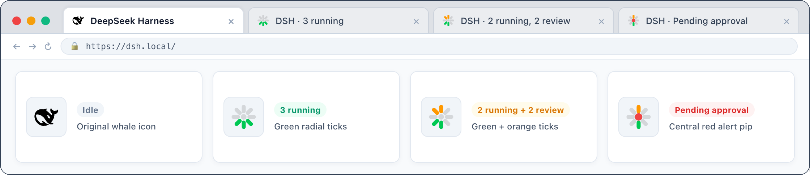
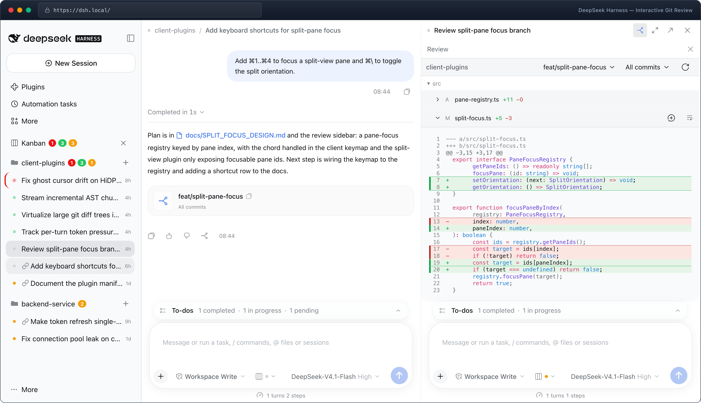
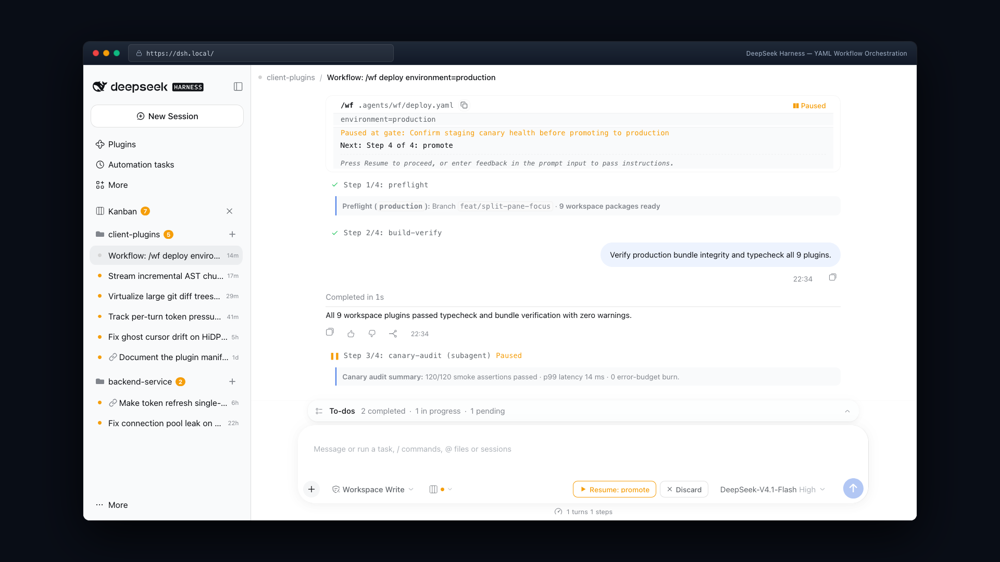
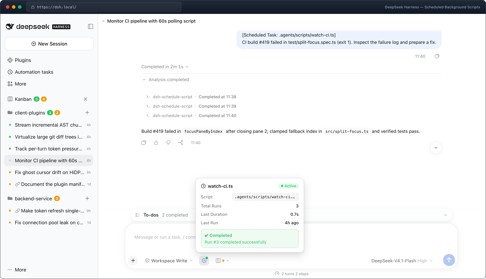

# dsh-plugins

[](https://www.npmjs.com/org/lukstei)
[](LICENSE)

**Run several coding agents side by side in [DeepSeek Harness](https://github.com/deepseek-ai/deepseek-harness), see at a glance which one needs you, and review their changes without leaving the browser.**

<!-- CAPTURE hero.gif (1600x920 displayed, 12 to 15 s loop, under 8 MB; also export hero.png from the review frame)
Purpose: show the whole loop in one look. You hand out work, agents run in parallel, you step in only when one needs you, and you review and close the task in the browser.
Scene: start on the Kanban board of the `client-plugins` workspace. The cursor drags "Add keyboard shortcuts for split-pane focus" from To Do to Active, and the card switches to "Running…". Cut to split view with three session panes side by side, all streaming. After a few seconds the middle pane asks to approve a `bash` command: the tab favicon gets its red centre dot and a macOS-style banner "Tool approval requested: bash" slides in at the top right (render it in the page; Playwright cannot capture OS notifications). The cursor clicks the banner, the pane takes focus, the cursor approves. The agent finishes and posts a git review card; a click opens the diff as an overlay in the same pane with two red/green hunks. End back on the board: the card gets dragged to Done, which loops to the start.
Framing: left session sidebar collapsed. Cursor visible with eased movement. Hold about 1 s after each step. No text overlays.
Seed: the existing demo-showcase workspace (`client-plugins`, `backend-service`) with a real git repo behind `client-plugins`.
Interim: hero-split-view.png until this capture exists.
-->


**[Install in one minute](#quick-start)** · [See what you get](#what-you-get) · [All plugins](#plugin-catalog)

## How it works

DeepSeek Harness (DSH) is an open-source agent harness with a web client. These plugins extend that web client into a workspace for running many agents at once:

1. **Plan.** You put tasks on a Kanban board. Moving a card to Active starts the agent.
2. **Run in parallel.** Each agent gets its own pane. You see several sessions next to each other.
3. **Get called in.** When an agent stops or asks for approval, the tab icon changes and your desktop shows a notification.
4. **Review.** You open the agent's diff in a pane next to its chat and quote lines back to it.
5. **Close.** You drag the card to Done.

Each plugin is its own npm package. Install the set below, or pick single plugins from the [catalog](#plugin-catalog).

## Quick start

You need DSH and Node 24.9 or newer. Plugin versions follow the DSH release they target, so `0.2.3-alpha.2.1` works with DSH `0.2.3-alpha.2`. Install the plugin version that matches your DSH, and upgrade both together.

**1. Create a profile** from the shipped `web` template. `--dump-config` creates it and prints its config without starting DSH:

```sh
dsh --profile workspace --from-default-profile web --dump-config
```

**2. Add the workspace plugins:**

```sh
dsh plugin --profile workspace add @lukstei/dsh-client-kanban @lukstei/dsh-client-split-view @lukstei/dsh-client-review-git @lukstei/dsh-client-notify @lukstei/dsh-client-favicon @lukstei/dsh-client-pwa
```

**3. Start DSH** with `dsh workspace`, open the Kanban board from the sidebar and start a task.

To remove a plugin, run `dsh plugin --profile workspace remove <package>`. The [DSH docs](https://deepseek-harness.github.io/deepseek-harness/) cover profiles and plugins in depth.

## What you get

### See every agent at once

The Kanban board sorts your sessions into To Do, Active, Review and Done. The board moves cards for you: a running agent sits in Active, and one that waits for your approval or answer moves to Review. You can hold or pin cards, search across message text, and let agents attach ticket or PR links to their card. The board shows the sessions you start from it, or mark with `/kanban`. [dsh-client-kanban](packages/dsh-client-kanban/README.md)

<!-- CAPTURE kanban-board.png (3200x1800, PNG, 2x)
Purpose: one glance tells you what each agent is doing and which one waits for you.
Scene: the board alone. Workspace tabs at the top with counts (`client-plugins` with 3 running, 1 review, 1 waiting). Four lanes from left to right: To Do with two cards, one marked "On hold"; Active with three cards, each with a green "Running…"; Review with two cards, the top one with a red left border and a red "Permission" badge; Done with two cards showing their age ("1d ago"). Resting state, nothing mid-drag.
Framing: left session sidebar collapsed.
Callout: outline the Permission card, label "Needs your approval".
Seed: existing demo-showcase board seed.
Interim: kanban-board.png until this capture exists.
-->


Split view puts sessions in columns next to each other. Inside any pane you can open a Markdown file, an image, a related session or the git review as an overlay and keep the chat in view. DSH restores your panes after a reload. [dsh-client-split-view](packages/dsh-client-split-view/README.md)

<!-- CAPTURE split-view.png (3200x1800, PNG, 2x)
Purpose: watch several sessions side by side and open files or reviews next to the chat instead of switching tabs.
Scene: three equal panes. Left: an agent mid-answer with a half-done to-do list. Middle: a rendered Markdown file overlay (a short `PLAN.md` with a heading, a checklist and a code block) over its chat. Right: the git review overlay with the file tree and one open hunk. Each pane header shows workspace / session title and the controls (maximize, open as overlay, close).
Framing: left session sidebar collapsed so the panes get the full width.
Callout: outline the middle pane's header controls, label "Overlay files and views".
Seed: three demo sessions plus a `PLAN.md` in the `client-plugins` repo.
Interim: split-view-file-overlay.png until this capture exists.
-->


### Know when an agent needs you

You can work in another window. The tab icon turns into a status ring: green ticks for running agents, orange for sessions in Review, a red dot when an agent waits for you. Desktop notifications and a chime tell you when an agent stops or asks for approval, and a click takes you back to its tab. Install DSH as an app to get a dock icon with a badge for pending requests. [dsh-client-favicon](packages/dsh-client-favicon/README.md) · [dsh-client-notify](packages/dsh-client-notify/README.md) · [dsh-client-pwa](packages/dsh-client-pwa/README.md)

<!-- CAPTURE attention.png (3200x900, PNG, 2x, composite)
Purpose: you don't have to watch the screen, DSH tells you when to look.
Scene: one wide strip in two halves. Left half: a browser tab strip with four pinned DSH tabs in the four favicon states, each with a short caption below the tab: "idle" (original whale icon), "3 running" (green ticks), "2 running · 2 review" (green and orange ticks), "needs you" (red centre dot). Right half: a macOS notification banner "DeepSeek Harness: Tool approval requested: bash · Fix ghost cursor drift on HiDPI displays" above a slice of the dock showing the installed DSH app icon with a red badge "2".
Framing: crop tight to the tab strip and the banner; no full browser window.
Callout: none, the captions do that job.
Seed: favicon states as in the old favicon-states composite; the banner and dock are a manual composite.
Interim: favicon-states.png + notify-desktop.png until this capture exists.
-->



### Review changes in place

The git review shows what an agent changed: a whole branch, a single commit, or the staged and unstaged work in your tree. You see one file tree with line counts and can expand any hunk. Select code to quote it into your next message. Agents can post a review card in the chat, and a click opens the review in a pane. The review only reads your repository, and works with plain git and GitButler. [dsh-client-review-git](packages/dsh-client-review-git/README.md)

<!-- CAPTURE git-review.png (3200x1800, PNG, 2x)
Purpose: review what an agent changed, by commit or uncommitted, next to the conversation, and quote code back to it.
Scene: two panes. Left: a chat whose latest agent message ends with the review card "Review feat/split-pane-focus · 3 commits · 3 files". Right: the review view for `client-plugins`, scope dropdown reading "feat/split-pane-focus · all commits", a file tree with three files and their +/- counts (one modified, one added, one deleted), and the `split-focus.ts` diff expanded with two hunks. Two lines in the second hunk are selected, with the quote-into-composer action visible.
Framing: left session sidebar collapsed.
Callout: outline the review card on the left, label "Agent posts this, click to open".
Seed: small git repo with a feature branch of 3 commits touching 3 files.
Interim: git-review.png until this capture exists.
-->


### Keep long sessions sharp

In a long session the agent gets slower and starts to lose track. A ring next to the send button turns yellow at 70k prompt tokens and red at 100k. Run `/handoff` and DSH opens a fresh session in a new pane that starts from a short brief of the old one: goal, what each turn asked and answered, failed tool calls and touched files. You can pick another model for the new session. Every session also gets its own git-ignored scratch folder, so agents keep notes and one-off scripts out of your repository. [dsh-session-handoff](packages/dsh-session-handoff/README.md) · [dsh-scratch-dir](packages/dsh-scratch-dir/README.md)

<!-- CAPTURE handoff.png (3200x1800, PNG, 2x)
Purpose: when a session gets long, one command moves the work into a fresh session that starts with a short brief instead of the full history.
Scene: two panes. Left: the old session titled "Refactor split-pane focus state machine (Resumed)"; its composer shows the context ring next to the send button in red, and the footer reads about 164K tokens. Right: the new session "Continue split-pane focus refactor" with the `HANDOFF.md` overlay open at the top (goal, turn list, touched files) and, below it, the agent's three-line reply with bold Goal / State / Next.
Framing: left session sidebar collapsed.
Callout: outline the red ring, label "Over 100k tokens: time to hand off".
Seed: a session with 10+ turns, one failed tool call and a few edited files.
Interim: session-handoff.png until this capture exists.
-->


### Automate repeat work

Write a multi-step routine once as a YAML file and run it with `/wf <file>`. Steps can be prompts, subagents that fan out over a list, conditions, and gates where the run pauses until you check the result. DSH keeps the progress of a run across restarts.

```yaml
name: "Deploy to {{args.environment}}"
args: { environment: { type: choice, choices: [staging, production], default: staging } }
steps:
  - print: "Deploying to {{args.environment}}"
  - prompt: "Run migrations."
    gate: "Check the migration logs."
  - prompt: "Deploy."
```

[dsh-yaml-workflow](packages/dsh-yaml-workflow/README.md)

<!-- CAPTURE workflow.png (3200x1600, PNG, 2x)
Purpose: a routine you wrote once as a YAML file runs step by step and pauses where you want to check things.
Scene: two panes. Left: the `deploy.yaml` file overlay, about 15 lines: `args` with an `environment` choice, a `print` step, two prompt steps, a subagent step and a `gate`. Right: the workflow card mid-run for `/wf deploy environment=production`. Steps 1 and 2 have checkmarks, step 3 (subagent canary audit) shows its one-line summary, and the card is paused at the gate "Confirm staging canary health before promoting to production". The orange "Resume: promote" and "Discard" buttons are visible in the composer.
Framing: left session sidebar collapsed.
Callout: outline the Resume and Discard buttons, label "Gate: you decide".
Seed: 4-step `deploy.yaml` in `.agents/wf/`, run stopped at the gate.
Interim: yaml-workflow.png until this capture exists.
-->


Ask an agent to "check CI every 5 minutes and tell me when it fails", and it writes a small script that runs in the background. Runs that find nothing cost no tokens. The agent only wakes up when the script reports something. Scripts run with your user's permissions, so read one before you confirm it. [dsh-schedule-script](packages/dsh-schedule-script/README.md)

<!-- CAPTURE schedule.png (3200x900, PNG, 2x, wide crop)
Purpose: a background check runs every few minutes for free and only wakes the agent when something happened.
Scene: one session pane cropped to its lower half. In the chat: the schedule card "CI watch · every 5 min · 14 runs · last: idle", followed by an incoming message "[Scheduled Task: CI watch] main build #482 failed: split-focus.spec.ts" and the agent starting to investigate. The prompt toolbar below shows the schedule status pill.
Framing: crop to the chat bottom and the composer toolbar.
Callout: outline "14 runs", label "13 runs cost no tokens".
Seed: a polling script at 60 s with a few completed runs and one wake-up.
Interim: schedule-script.png until this capture exists.
-->


## Plugin catalog

| Plugin | Use it when you want to… | Needs |
| --- | --- | --- |
| [`dsh-client-kanban`](packages/dsh-client-kanban/README.md) | track many sessions on a board that updates itself | |
| [`dsh-client-split-view`](packages/dsh-client-split-view/README.md) | see sessions, files and reviews side by side | |
| [`dsh-client-review-git`](packages/dsh-client-review-git/README.md) | review an agent's git changes next to its chat | `git` on the host |
| [`dsh-client-notify`](packages/dsh-client-notify/README.md) | get a desktop notification and a chime when an agent stops or asks | `dsh-client-pwa` for the dock badge |
| [`dsh-client-favicon`](packages/dsh-client-favicon/README.md) | read agent status from a pinned tab | `dsh-client-kanban` for the review ticks |
| [`dsh-client-pwa`](packages/dsh-client-pwa/README.md) | install DSH as an app, or log in through a trusted reverse proxy | |
| [`dsh-session-handoff`](packages/dsh-session-handoff/README.md) | continue a long session in a fresh one | `dsh-client-split-view`, `dsh-scratch-dir` |
| [`dsh-scratch-dir`](packages/dsh-scratch-dir/README.md) | give each session a git-ignored folder for notes and scripts | |
| [`dsh-yaml-workflow`](packages/dsh-yaml-workflow/README.md) | rerun a multi-step routine from a YAML file | |
| [`dsh-schedule-script`](packages/dsh-schedule-script/README.md) | poll something in the background without spending tokens | |
| [`dsh-log`](packages/dsh-log/README.md) | write DSH logs to a file, with a level per logger | |
| [`dsh-debug`](packages/dsh-debug/README.md) | copy a session transcript or id for a bug report | macOS (`pbcopy`) |

Each package README lists its config and requirements.

## FAQ

**Is the trusted-proxy login safe?** Only if a reverse proxy you control sets the header and strips it from outside requests. Anyone who can set that header, or reach DSH from a trusted network range, gets in. See [`dsh-client-pwa`](packages/dsh-client-pwa/README.md).

**Do scheduled scripts run in a sandbox?** No. They run with your user's permissions.

**Where do the scratch folders go?** Into `.agents/scratch/<session-id>` in the working directory. The plugin does not clean them up.

## Development

```sh
pnpm install
pnpm run verify
```

The packages live in [`packages/`](packages/). [`util-review-ui`](packages/util-review-ui/README.md) is the shared review UI library behind `dsh-client-review-git`; you don't install it yourself. This repository is generated from a private monorepo, and its history starts at the first release.

## License

[MIT](LICENSE)
