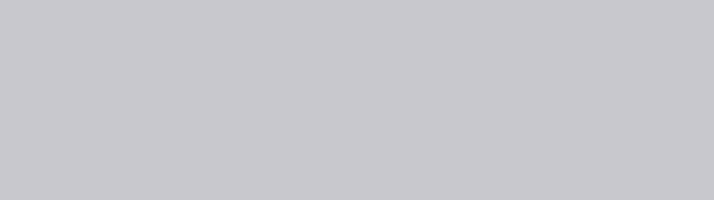
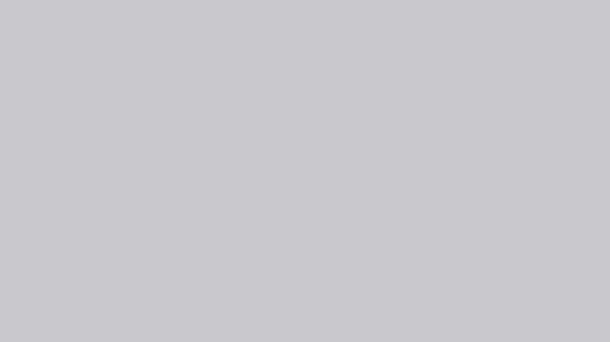
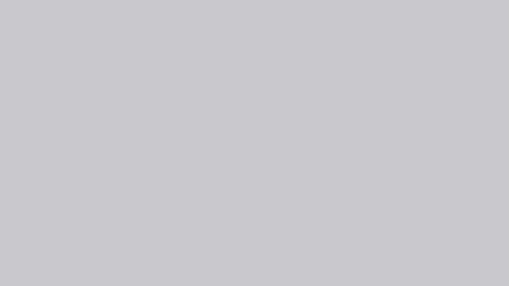
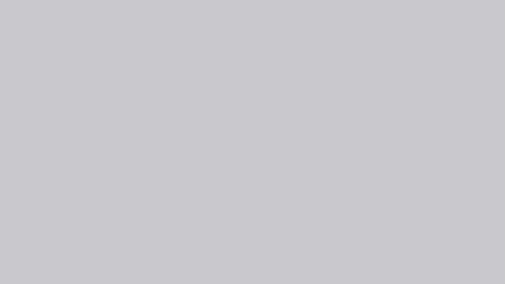
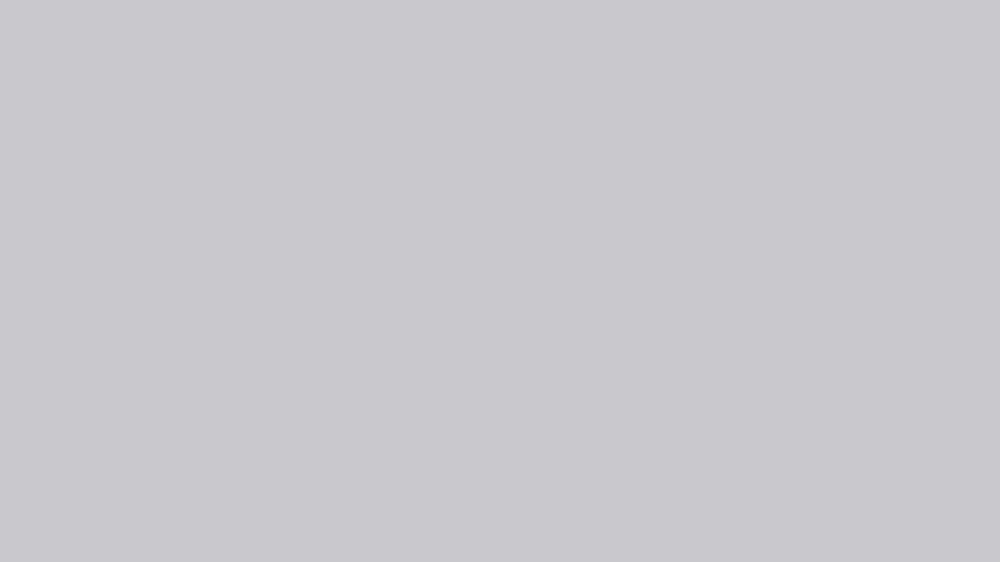
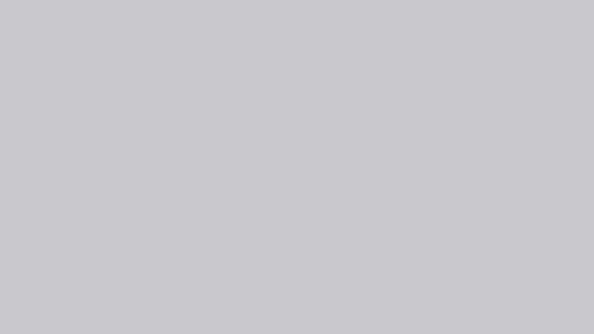

# dsh-plugins

[](https://www.npmjs.com/org/lukstei)
[](LICENSE)

Plugins for [DeepSeek Harness](https://github.com/deepseek-ai) (DSH) that turn the web client into a workspace for running several agents at once. You get a Kanban board, side-by-side sessions, a git review view, notifications, YAML workflows and a few reliability fixes. Each plugin installs on its own from npm.


- [Why these plugins](#why-these-plugins)
- [Plugins at a glance](#plugins-at-a-glance)
- [Quick start](#quick-start)
- [Screenshots](#screenshots)
- [Plugin details](#plugin-details)
- [Recommended setups](#recommended-setups)
- [FAQ](#faq)
- [Development](#development)

## Why these plugins

DSH runs one conversation at a time and tells you little while you look elsewhere. These plugins cover what you miss once you run several agents in parallel.

- **Overview.** A Kanban board shows which sessions run, wait for you or are done. Split view puts several sessions next to each other.
- **Review.** A standalone git review shows branches, commits and uncommitted changes, and can sit in a split-view pane.
- **Awareness.** Desktop notifications, a chime, an app badge and a status favicon tell you when an agent stops or needs approval. You can install DSH as an app.
- **Automation.** YAML workflows run multi-step prompts you wrote yourself. Scheduled scripts poll in the background and wake the agent only when something changed.
- **Context.** `/handoff` moves a long session into a fresh one with a short brief. Every session gets its own scratch folder.
- **Reliability.** Per-logger log files, a session list that survives a corrupt log, and commands that copy a transcript for bug reports.

## Plugins at a glance

| Plugin | What it does | Gap it fills (vs. upstream DSH) |
| --- | --- | --- |
| **Multi-session workflow** | | |
| [`dsh-client-kanban`](packages/dsh-client-kanban/README.md) | Four-lane Kanban board for sessions | Upstream lists sessions in a flat list. No board, no review, done or hold states. |
| [`dsh-client-split-view`](packages/dsh-client-split-view/README.md) | Side-by-side session panes with file and plugin overlays | Upstream shows one session in the main area. Files open only in the right sidebar. |
| [`dsh-session-handoff`](packages/dsh-session-handoff/README.md) | `/handoff` resume brief into a fresh session | Upstream has compaction and Ralph handoff, but no command that starts a new session from a brief. |
| [`dsh-scratch-dir`](packages/dsh-scratch-dir/README.md) | Per-session git-ignored scratch folder | Upstream has no per-session scratch folder. |
| **Code review** | | |
| [`dsh-client-review-git`](packages/dsh-client-review-git/README.md) | Git and GitButler diff review view and in-chat review card | Upstream has a review tab. This one is a separate view that also runs inside a split-view pane. |
| **Automation** | | |
| [`dsh-yaml-workflow`](packages/dsh-yaml-workflow/README.md) | Multi-step prompt workflows from YAML files (`/wf`) | Upstream's `workflow` tool is a script the model writes. You cannot run your own workflow file. |
| [`dsh-schedule-script`](packages/dsh-schedule-script/README.md) | Recurring background scripts that wake the agent only when needed | Every upstream schedule run invokes the model. |
| **Awareness and access** | | |
| [`dsh-client-notify`](packages/dsh-client-notify/README.md) | Desktop notifications, chimes and app badge | Upstream sends no notification, sound or badge. |
| [`dsh-client-favicon`](packages/dsh-client-favicon/README.md) | Tab favicon as a live status ring | Upstream keeps a static favicon. |
| [`dsh-client-pwa`](packages/dsh-client-pwa/README.md) | Installable app and trusted-proxy login | Upstream is not installable as an app and logs in with a launch token only. |
| **Observability and reliability** | | |
| [`dsh-log`](packages/dsh-log/README.md) | Per-logger log files and levels | Upstream logging has no file output and no per-logger levels. |
| [`dsh-resilient-persistence`](packages/dsh-resilient-persistence/README.md) | Corrupt session logs no longer break the session list | In upstream, one corrupt session log breaks the session list. |
| [`dsh-debug`](packages/dsh-debug/README.md) | `/copy-transcript` and `/copy-session-id` | Upstream has no command to copy a transcript or session id. |
| **Internals** | | |
| [`util-review-ui`](packages/util-review-ui/README.md) | Shared review UI used by review-git | Library. It comes in as a dependency of `dsh-client-review-git`. |

## Quick start

<!-- re-check after the install smoke test passes -->

You need DSH with Node 24.9 or newer. Add a plugin to a profile:

```sh
dsh plugin --profile <profile-name> add @lukstei/dsh-client-kanban
```

`add` installs the package and mounts it in the profile. Restart DSH, and the plugin is active. To remove it:

```sh
dsh plugin --profile <profile-name> remove @lukstei/dsh-client-kanban
```

Replace the package name to install any plugin from the table above. Several plugins work better together. See [Recommended setups](#recommended-setups).

## Screenshots

Split view with eight parallel sessions on an ultra-wide display:



The Kanban board, with sessions in four lanes:


Git review of a feature branch:


## Plugin details

Each block links to the package README for config and requirements.

### Multi-session workflow

#### dsh-client-kanban

**Gap it fills:** upstream lists sessions in a flat list. With several agents running, you cannot tell which one waits for you.

- Four lanes: To Do, Active, Review and Done. A session moves on its own: running means Active, waiting for approval or input means Review.
- Drag cards between lanes, or use the card buttons. Moving a card from To Do to Active starts the prepared prompt.
- Hold, pin or delete a session. Done cards hide after 7 days unless you pin them.
- Workspace tabs and a search box that also looks through message text.
- Agents can attach ticket, PR or session links to a card with the `kanban_add_link` tool.

Only sessions started from the board appear on it. Run `/kanban` in a session to enable the board for it. Works best with split view, favicon and notify. [Package README](packages/dsh-client-kanban/README.md)



#### dsh-client-split-view

**Gap it fills:** upstream shows one session in the main area, and files open only in the right sidebar.

- Sessions sit in equal-width columns. Maximize, close or reorder them by dragging the header.
- Open a Markdown file, an image, a related session or another plugin's view, such as the git review, as an overlay inside a pane.
- Open panes survive a reload. On a phone you see one pane at a time.

No config. Other plugins use it to open their views in panes. `dsh-session-handoff` requires it. [Package README](packages/dsh-client-split-view/README.md)



#### dsh-session-handoff

**Gap it fills:** upstream compacts a session or hands off between Ralph rounds, but cannot start a new session from a short brief of the old one.

- `/handoff` creates a new session in a split pane. It contains a `HANDOFF.md` with the goal, each turn's ask and reply, tool failures and touched files. The agent answers with Goal, State and Next.
- The old session is renamed "(Resumed)" and marked done on the Kanban board.
- `/handoff <session-id>` writes the brief of another session into the current session's scratch folder.
- A ring next to the send button turns yellow at 70k prompt tokens and red at 100k. It tells you when a handoff makes sense.

Requires `dsh-client-split-view` and `dsh-scratch-dir`. [Package README](packages/dsh-session-handoff/README.md)



#### dsh-scratch-dir

**Gap it fills:** upstream gives agents no place for temporary files, so notes and scripts end up in your repository.

- Creates `.agents/scratch/<session-id>` for each session and tells the agent its path in the system prompt.
- Adds a `.gitignore` so scratch files never reach git.
- Nothing cleans the folders up.

No config. [Package README](packages/dsh-scratch-dir/README.md)

### Code review

#### dsh-client-review-git

**Gap it fills:** upstream has a review tab. This plugin is a separate review view that you can also open inside a split-view pane, with git and GitButler scopes.

- Scopes: a branch against its merge base (all commits or a single commit), and the working tree split into staged and unstaged changes.
- One file tree with added and removed line counts. Hunks expand to show more context.
- It finds repositories from the files the session edited, and offers a repository dropdown.
- Select code and quote it into the composer.
- The `git_review_present` tool posts a review card in the chat. A click opens the review.
- Read-only. It never checks out or fetches.

Needs `git` on the host. GitButler is optional. [Package README](packages/dsh-client-review-git/README.md)

### Automation

#### dsh-yaml-workflow

**Gap it fills:** upstream's `workflow` tool is a script the model writes at run time. You cannot keep a workflow in a file and run it again.

- `/wf <file> key=value` runs a YAML file step by step. The file is validated before the first step.
- Steps are prompts, `print` lines that cost no tokens, `gate` pauses for your review, `if` conditions and subagent steps. Subagent output can fan out over a list with `foreach`.
- Typed arguments with defaults and choices.
- A workflow card in the chat shows each step and has Resume and Discard buttons. Progress survives a restart.
- `/wf-list`, `/wf-validate`, `/wf-resume` and `/wf-abort` manage runs.

```yaml
name: "Deploy to {{args.environment}}"
args: { environment: { type: choice, choices: [staging, production], default: staging } }
steps:
  - print: "Deploying to {{args.environment}}"
  - prompt: "Run migrations."
    gate: "Check the migration logs."
  - prompt: "Deploy."
```

Run it with `/wf deploy environment=production`. DSH looks in the working directory, `.agents/wf/` and `~/.agents/wf/`. [Package README](packages/dsh-yaml-workflow/README.md)


#### dsh-schedule-script

**Gap it fills:** every upstream schedule run invokes the model, even when nothing happened.

- Ask for "check CI every 5 minutes and tell me only when it fails". The agent writes a TypeScript script and runs it once to test it.
- After you confirm, the script runs on a timer, at least 60 seconds apart. It keeps its own state between runs.
- A run that finds nothing costs no tokens. When the script returns a prompt, it arrives as a `[Scheduled Task: ...]` message and wakes the agent.
- A status pill in the prompt toolbar and a card in the chat show runs, last state and last error.

One script schedule per session. Scripts are not sandboxed and run with your permissions. [Package README](packages/dsh-schedule-script/README.md)


### Awareness and access

#### dsh-client-notify

**Gap it fills:** upstream tells you nothing while the tab is in the background.

- Desktop notifications for "Agent stopped", tool approval requests, questions and required actions.
- Two chimes: a soft one when an agent stops, a sharper one when it needs you.
- Debounced, so a burst of events gives one notification. Subagents stay quiet. While the tab has focus, you only hear the chime.
- With the installed app, the dock icon shows a badge with the number of pending requests.
- A click on the notification focuses the DSH tab.

The browser asks for notification permission on your first click or keypress. [Package README](packages/dsh-client-notify/README.md)



#### dsh-client-favicon

**Gap it fills:** upstream keeps a static favicon, so a pinned tab never shows agent state.

- The favicon becomes a ring of 8 ticks. Green ticks fill from the bottom for each running session.
- Orange ticks fill from the top for sessions waiting for review. This needs the Kanban plugin.
- A red dot in the center means an agent waits for your approval or answer.
- The original favicon returns when everything is idle.

No permissions, no config. [Package README](packages/dsh-client-favicon/README.md)


#### dsh-client-pwa

**Gap it fills:** upstream is not installable as an app, and you log in with a launch token only.

- Serves the manifest and icons, so the browser offers "Install app". You get a standalone window and a dock icon.
- Logs you in from a trusted reverse-proxy header or trusted network ranges, for example behind Tailscale. No token to type.
- Name, colors, start URL and path prefixes are configurable.
- Needed for the app badge of `dsh-client-notify`.

Trusting a header or network range grants access to everyone who can set it. Check the proxy setup before you enable it. [Package README](packages/dsh-client-pwa/README.md)



### Observability and reliability

#### dsh-log

**Gap it fills:** upstream logging has no file output and no per-logger levels.

- Writes logs to stdout, to a file or to both.
- Sets a level per logger and output: `-1` silences, `0` error, `1` warn, `2` info, `3` debug. Setting the default to `-1` and naming a few loggers gives you an include list.
- Line format: `<ISO timestamp> [<LEVEL>] [<logger>] <message>`.

No rotation and no size cap. [Package README](packages/dsh-log/README.md)

#### dsh-resilient-persistence

**Gap it fills:** in upstream, one corrupt session log breaks the session list.

- Opens each listed session once to test it, and leaves out the ones that fail.
- Logs one warning per corrupt session with the error.
- Caches the result until the session changes, and checks 16 sessions in parallel.
- Also hides logs written by a newer DSH with event types your version does not know.

It hides sessions and does not repair them. Delete the session folder to remove one. This plugin patches an upstream function, so a DSH persistence change can break it. [Package README](packages/dsh-resilient-persistence/README.md)

#### dsh-debug

**Gap it fills:** upstream has no command to copy a transcript or session id.

- `/copy-transcript` copies all session events as JSON Lines to your clipboard. Paste it into a bug report.
- `/copy-session-id` copies the session id.

Uses `pbcopy`, so it works on macOS only. [Package README](packages/dsh-debug/README.md)

## Recommended setups

<!-- re-check after the install smoke test passes -->

**Web workspace.** Run several agents and stay informed.

```sh
for p in dsh-client-kanban dsh-client-split-view dsh-client-review-git dsh-client-notify dsh-client-favicon dsh-client-pwa; do
  dsh plugin --profile <profile-name> add @lukstei/$p
done
```

Kanban shows the state, split view shows the sessions, review-git shows the changes. Notify, favicon and pwa tell you when to look. The app badge needs notify and pwa. The review ticks in the favicon need Kanban.

**Automation and long sessions.** Workflows, background checks and session handoff.

```sh
for p in dsh-yaml-workflow dsh-schedule-script dsh-session-handoff dsh-scratch-dir dsh-client-split-view; do
  dsh plugin --profile <profile-name> add @lukstei/$p
done
```

Handoff needs split view and the scratch folder, so install all three together. Add Kanban to mark the old session done after a handoff.

**Reliability.** Add `dsh-log`, `dsh-resilient-persistence` and `dsh-debug` to any profile.

## FAQ

**Which DSH version does a plugin support?** Versions follow the DSH release they target: `<dsh-version>.<n>`. For example, `0.2.3-alpha.2.1` targets DSH `0.2.3-alpha.2`. Install the plugin version that matches your DSH.

**What happens when I upgrade DSH?** Upgrade the plugins together with DSH. `dsh-resilient-persistence` patches an upstream function and `dsh-client-review-git` expects host and client to update together.

**Which plugins need each other?** `dsh-session-handoff` needs `dsh-client-split-view` and `dsh-scratch-dir`. `dsh-client-notify` needs `dsh-client-pwa` for the app badge. The favicon's review ticks and the handoff's "done" mark need `dsh-client-kanban`. Each package README lists its requirements.

**Is it safe to enable the trusted-proxy login?** Only if a reverse proxy you control sets the header and strips it from outside requests. See `dsh-client-pwa` above.

**Do scheduled scripts run in a sandbox?** No. They run with your user's permissions. Read a script before you confirm it.

## Development

```sh
pnpm install
pnpm run verify
```

The packages live in [`packages/`](packages/). This repository is generated from a private monorepo; history starts at the first release.

## License

[MIT](LICENSE)
