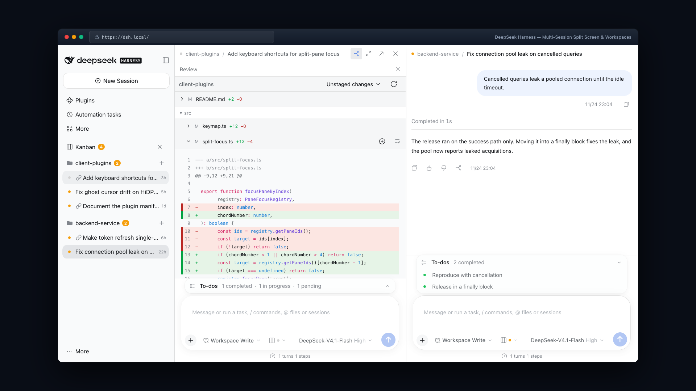
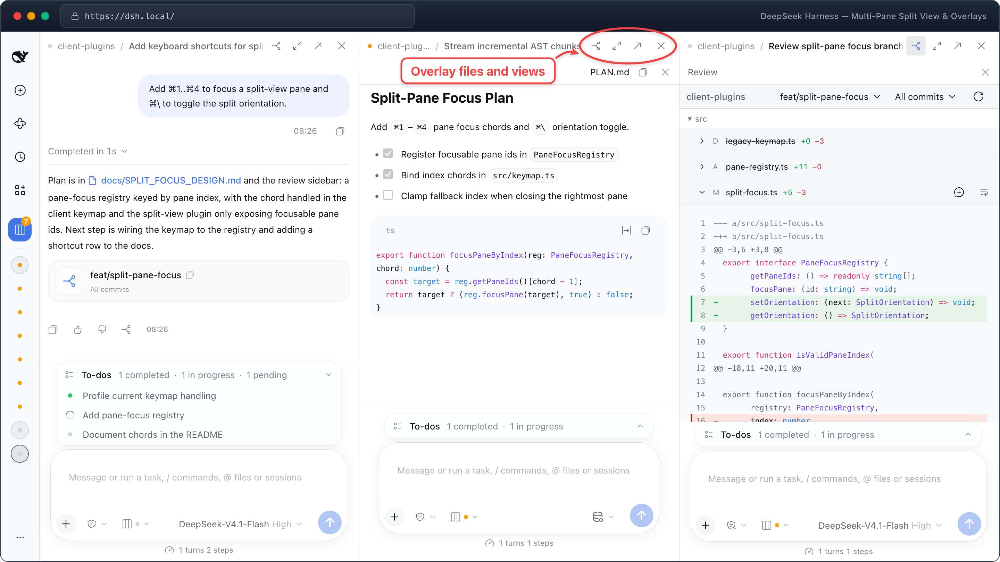
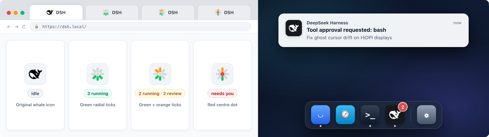
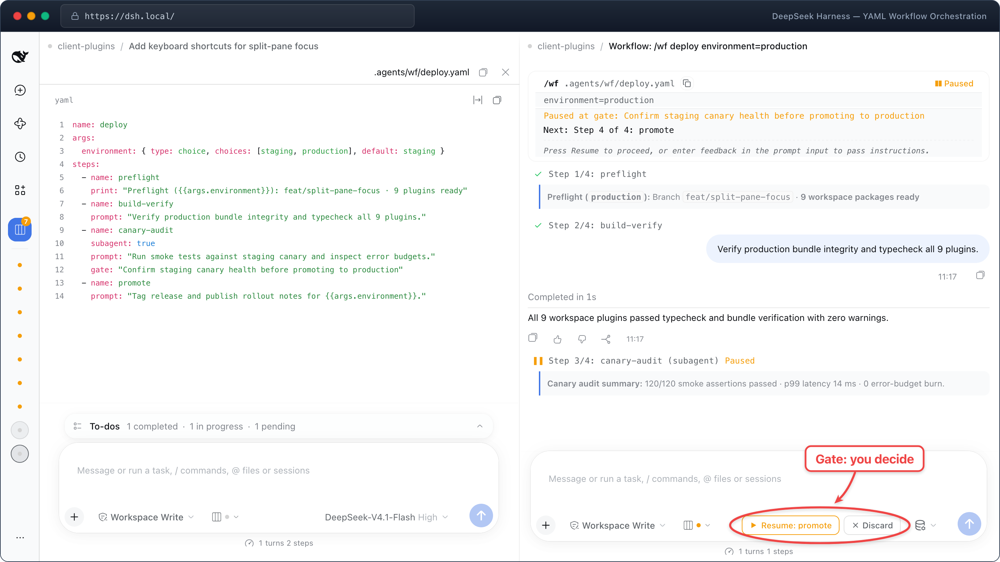
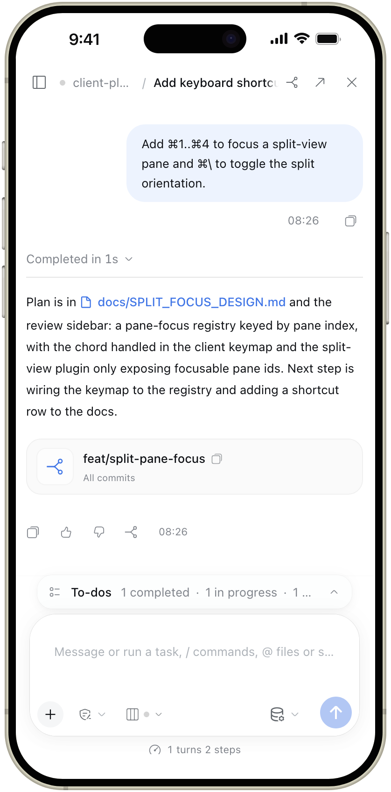

# dsh-plugins

[](https://github.com/lukstei/dsh-plugins/releases)
[](https://www.npmjs.com/search?q=%40lukstei%2Fdsh-)
[](https://github.com/lukstei/dsh-plugins/actions/workflows/ci.yml)
[](LICENSE)

**Run several coding agents side by side in [DeepSeek Harness](https://github.com/deepseek-ai/deepseek-harness), spot which one needs you, and review their changes in the browser.**



**[Starter setup](#starter-setup)** · [Workspace features](#workspace-features) · [Standalone utilities](#standalone-utilities) · [Plugin catalog](#plugin-catalog)

## How it works

DeepSeek Harness (DSH) is an open-source agent harness with a web client. The starter set turns that web client into a multi-agent workspace:

1. **Plan.** Add tasks to a Kanban board. Moving a card to Active starts the agent.
2. **Run in parallel.** Open sessions in side-by-side panes.
3. **Spot attention requests.** The tab icon and desktop notifications tell you when an agent stops or waits for approval.
4. **Review.** Inspect the branch, commit, or working tree diff beside the chat and quote lines back to the agent.
5. **Hand off or close.** Start a fresh session with a brief when context fills up, or move the card to Done.

Each plugin is its own npm package. Install the full starter set below, or add standalone utilities as you need them.

## Philosophy

- **Minimal model impact.** Most of these plugins make you faster by changing the harness UI and leave the agent's context alone. Where I can, I avoid adding tools, prompt text, or instructions for the model. Keeping my agent's context small and free of conflicting instructions is one of my top priorities. Each plugin README has a "Model Experience" section that describes the text or UI the plugin adds for the model, along with its token and cache cost.
- **Unopinionated.** I built these plugins for my own setup, but I keep them generic so they don't assume a particular workload and fit your workflow too.
- **Intuitive.** If a plugin's behavior, a UI element, or a piece of text confuses you, [open an issue](https://github.com/lukstei/dsh-plugins/issues).
- **Built on DSH core.** I reuse or extend existing DSH features wherever I can. For example, `dsh-schedule-script` hooks into the native DSH scheduler and its UI and adds only the missing parts. When a DSH release fills a gap that one of my plugins covers, I plan to retire that plugin.
- **Breaking changes.** DeepSeek Harness is still in alpha, so a plugin release may change the UI or the config format. I try to avoid that. I don't break persisted session state unless an upstream DSH change forces it. I list breaking changes in the [release notes](https://github.com/lukstei/dsh-plugins/releases).

## Starter setup

You need DSH and Node 24.9 or newer.

Plugin versions follow `<dsh-version>.<n>`, where `<dsh-version>` is the DSH release they target and `<n>` counts plugin releases for that target (for example, `0.2.2-rc.5.1` targets DSH `0.2.2-rc.5`). You can update `<n>` on the same DSH version, and you should upgrade DSH and the plugins together when moving to a new DSH release.

I do not support mixing plugin and harness versions across DSH releases, though most plugins still work across nearby `0.2.x` builds. DSH changes plugin APIs between releases, so a newer plugin can fail on an older harness and an older plugin can break on a newer one. These packages declare `*` peer ranges and omit `engines.dsh`, so `dsh plugin add` does not block a mismatch at install time. Pin a matching release with `@lukstei/<package>@<dsh-version>.<n>` if you hit a conflict or your DSH install is behind `latest`.

**1. Install the Kanban workspace suite** into your profile (`web` or `desktop`):

```sh
dsh plugin --profile <web|desktop> add \
  @lukstei/dsh-client-kanban \
  @lukstei/dsh-client-split-view \
  @lukstei/dsh-client-review-git \
  @lukstei/dsh-client-notify \
  @lukstei/dsh-client-favicon \
  @lukstei/dsh-session-handoff
```

**2. Start DSH** (for example `dsh web`), open the Kanban board from the sidebar, and start a task.

Each package ships a default `cordis.patch.yml`, so `dsh plugin add` mounts it with working defaults. If you want to customize Kanban link-tool instructions or handoff ring thresholds, override them in your profile `cordis.patch.yml`:

```yaml
- id: kanban
  config:
    linkTool:
      enabled: true # default
      instructions: >- # default
        Collect important links relevant to the session. Keep link labels concise and unambiguous.
        Give links directly related to the task negative priorities; give supporting context links zero or positive priorities.
        For context links, briefly explain their relevance in the label.
        Examples: "Task PR: lukstei/dsh-plugins #32", "Task Ticket: EXAMPLE-2", "EXAMPLE-333: Acceptance criteria".

- id: session-handoff
  config:
    defaults: { warmSoft: 100000, warmStrong: 150000 }
```

To remove a plugin, run `dsh plugin --profile <web|desktop> remove <package>`. The [DSH docs](https://deepseek-harness.github.io/deepseek-harness/) cover profiles and plugins in depth.

## Workspace features

### Kanban board

**Plugin:** [`@lukstei/dsh-client-kanban`](packages/dsh-client-kanban/README.md)

The board sorts managed sessions into To Do, Active, Review, and Done. Running agents sit in Active, and sessions waiting for your approval or answer move to Review. You can hold or pin cards, search message text, and let agents attach ticket or PR links. The board shows sessions you start from it or mark with `/kanban`.


### Split view

**Plugin:** [`@lukstei/dsh-client-split-view`](packages/dsh-client-split-view/README.md)

Split view puts sessions in side-by-side columns. Inside any pane you can open a Markdown file, an image, a related session, or the git review as an overlay while keeping the chat visible. DSH restores your open panes after a reload.



### Tab status and desktop alerts

**Plugins:** [`@lukstei/dsh-client-favicon`](packages/dsh-client-favicon/README.md) (tab ring) · [`@lukstei/dsh-client-notify`](packages/dsh-client-notify/README.md) (notifications, chime, app badge)

The browser tab icon renders an eight-tick ring: green ticks for running agents, orange ticks for sessions in Review, and a red center dot when an agent waits for you. Desktop notifications and a chime fire when an agent stops or asks for approval, and clicking a notification focuses that tab. If you install DSH as a PWA, the app icon shows a badge for pending interactions and recent reviews.



### Git review in place

**Plugin:** [`@lukstei/dsh-client-review-git`](packages/dsh-client-review-git/README.md)

Inspect a branch, a single commit, or staged and unstaged changes across every repository a session touched. You get a unified file tree with line counts, expandable hunks, and selection quoting back into the composer. Agents can also post a review card in chat that opens the review pane. Reads never alter repository state and work with both plain Git and GitButler.


### Session handoff

**Plugin:** [`@lukstei/dsh-session-handoff`](packages/dsh-session-handoff/README.md)

A ring next to the send button changes color as prompt context grows; thresholds are configurable per provider and model. Run `/handoff` (or click the ring) to open a fresh session in a new pane seeded with a brief of the old one: goal, turn summaries, failed tool calls, and touched files. You can switch models across native and ACP backends when handing off.


## Standalone utilities

These packages work on their own without the Kanban workspace suite. Install any of them with `dsh plugin --profile <profile> add <package>`. Each package ships a default `cordis.patch.yml`, so `dsh plugin add` mounts it with working defaults; only add entries to your profile `cordis.patch.yml` when overriding config.

### YAML workflows

**Plugin:** [`@lukstei/dsh-yaml-workflow`](packages/dsh-yaml-workflow/README.md)

Define multi-step prompt routines in YAML and run them with `/wf <file>`. Steps support prompts, subagent fan-out over lists, conditionals, zero-token print blocks, and approval gates that pause until you resume. DSH keeps run state across restarts.

```yaml
name: 'Deploy to {{args.environment}}'
args: { environment: { type: choice, choices: [staging, production], default: staging } }
steps:
  - print: 'Deploying to {{args.environment}}'
  - prompt: 'Run migrations.'
    gate: 'Check the migration logs.'
  - prompt: 'Deploy.'
```



**Examples (from my own `~/.agents/wf` setup, optional)**

Copy any of these into `~/.agents/wf/` (or `.agents/wf/` in a project) and run them with `/wf <name>`:

- **[`review.yaml`](packages/dsh-yaml-workflow/examples/review.yaml)** (`/wf review`, `/wf review fix=false <scope>`): Unified code review. Scopes the diff or folder, delegates a correctness review and an AP1-AP14 antipattern scan to subagents, triages findings, optionally pauses at a gate (`wait=true`), and either applies verified fixes (`fix=true`, default) or writes proposed PR comments (`fix=false`). *(Prompts reference optional `ponytail` and `no-ai-slop` skills.)*
- **[`socratic.yaml`](packages/dsh-yaml-workflow/examples/socratic.yaml)** (`/wf socratic`, `/wf socratic packages/foo`): Context-free Socratic review. A subagent reads only the code or diff and asks up to 6 open questions (`Q1-Q6`), the parent agent answers from code and history to decide verdicts, pauses at a gate (`wait=true`, default), and applies accepted changes (`fix=true`).
- **[`write.yaml`](packages/dsh-yaml-workflow/examples/write.yaml)** (`/wf write <notes or draft>`): Technical prose workflow. Builds a grounded brief, drafts or extracts text, runs subagent substance and slop/cadence audits (`TS1-TS10`), triages edits, and writes the final prose.

### Scheduled background scripts

**Plugin:** [`@lukstei/dsh-schedule-script`](packages/dsh-schedule-script/README.md)

Ask an agent to poll a condition on an interval (for example, checking CI every 5 minutes and reporting failures). It writes a TypeScript check that runs in the background without spending tokens; the agent wakes only when the script returns a prompt. Scripts run with your user permissions, so review one before confirming it.


### Per-session scratch folders

**Plugin:** [`@lukstei/dsh-scratch-dir`](packages/dsh-scratch-dir/README.md)

Creates `.agents/scratch/<session-id>` in the session working directory with a local `.gitignore` and adds its path to the agent system prompt. Agents write plans, notes, and throwaway scripts there instead of polluting your repository root.

### File and stdout logger

**Plugin:** [`@lukstei/dsh-log`](packages/dsh-log/README.md)

Routes Cordis logger output to stdout or log files with per-logger level thresholds (`-1` silenced up to `3` DEBUG). The shipped patch logs `INFO` to stdout; override `outputs` in `cordis.patch.yml` to write selected loggers to disk:

```yaml
- id: file-log
  config:
    outputs:
      - target: stdout
        levels: { default: 2 }
      - target: file
        filePath: ~/.dsh/logs/dsh.log
        levels: { default: -1, tools: 3 }
```

### Transcript and session ID copy

**Plugin:** [`@lukstei/dsh-debug`](packages/dsh-debug/README.md)

Adds `/copy-transcript` (JSON Lines of all snapshot events) and `/copy-session-id` to copy debugging context to your clipboard. The default writer uses `pbcopy` on macOS; programmatic setups can pass a custom `copy` handler.

### PWA and optional proxy login

**Plugin:** [`@lukstei/dsh-client-pwa`](packages/dsh-client-pwa/README.md)

Serves a web app manifest and icons so you can install DSH as a standalone app, and adds optional reverse-proxy auth. The shipped patch leaves `config` empty so trusted-proxy login stays off by default.

**Example 1: Localhost PWA** (installable app on `localhost`, standard DSH token login):

No `cordis.patch.yml` entry is needed after `dsh plugin --profile web add @lukstei/dsh-client-pwa`—the shipped patch already enables the manifest and icons.

**Example 2: Tailscale Serve (my own setup, optional)**

This is an example from my own setup for reaching local DSH from a phone. You do not need Tailscale or reverse-proxy login for desktop use; any authenticating HTTPS proxy works if you match its headers and IP range.

Expose local DSH on your tailnet with Tailscale Serve:

```sh
tailscale serve --service=svc:dsh --https=443 http://localhost:3080
```

Then override `client-pwa` in your profile `cordis.patch.yml`:

```yaml
- id: client-pwa
  config:
    auth:
      userHeader: 'tailscale-user-login'
      trustedCidrs: ['127.0.0.1', '::1', '100.64.0.0/10', 'fd7a:115c:a1e0::/48']
      authRoutes: ['/login', '/auth/tailscale', '/auto-login']
      loginRedirectPath: '/login'
    pwa:
      pathPrefixes: ['/tsctl'] # optional: only needed when mounted under a subpath
```

Tailscale terminates HTTPS at `https://dsh.<tailnet>.ts.net` and injects `tailscale-user-login`. Requests from your tailnet sign in without a token, and Safari or Chrome can add DSH to your home screen. On phone viewports, Kanban stacks into one column and split view shows one session at a time.



## Plugin catalog

| Plugin | Dependencies |
| --- | --- |
| [`@lukstei/dsh-client-kanban`](packages/dsh-client-kanban/README.md)<br>Track many sessions on a live board | • **Optional:** `dsh-client-split-view` (opens panes + pane status dots)<br>• **Optional:** `dsh-client-favicon` (review ticks in tab ring)<br>• **Optional:** `dsh-client-notify` (review count in app badge) |
| [`@lukstei/dsh-client-split-view`](packages/dsh-client-split-view/README.md)<br>View sessions, files, and reviews side by side | |
| [`@lukstei/dsh-client-review-git`](packages/dsh-client-review-git/README.md)<br>Review git changes next to the chat | • **Required:** `git` on host<br>• **Optional:** `dsh-client-split-view` (pane-header review button + overlay) |
| [`@lukstei/dsh-client-notify`](packages/dsh-client-notify/README.md)<br>Get desktop alerts and a chime when an agent stops or asks | • **Optional:** `dsh-client-kanban` (includes review count in badge)<br>• **Optional:** `dsh-client-pwa` (installable app for dock/home-screen badge) |
| [`@lukstei/dsh-client-favicon`](packages/dsh-client-favicon/README.md)<br>Read agent status from a pinned tab | • **Optional:** `dsh-client-kanban` (orange review ticks) |
| [`@lukstei/dsh-session-handoff`](packages/dsh-session-handoff/README.md)<br>Continue a long session in a fresh one | • **Optional:** `dsh-client-split-view` (handoff ring, model picker UI, side-pane launch; `/handoff` works on host without it) |
| [`@lukstei/dsh-yaml-workflow`](packages/dsh-yaml-workflow/README.md)<br>Rerun a multi-step routine from a YAML file | |
| [`@lukstei/dsh-schedule-script`](packages/dsh-schedule-script/README.md)<br>Poll something in the background without spending tokens | |
| [`@lukstei/dsh-scratch-dir`](packages/dsh-scratch-dir/README.md)<br>Give each session a git-ignored folder for notes and scripts | |
| [`@lukstei/dsh-log`](packages/dsh-log/README.md)<br>Write DSH logs to stdout or files per logger | |
| [`@lukstei/dsh-debug`](packages/dsh-debug/README.md)<br>Copy a session transcript or id for a bug report | • **Required:** macOS (`pbcopy`) by default |
| [`@lukstei/dsh-client-pwa`](packages/dsh-client-pwa/README.md)<br>Install DSH as a PWA or sign in via a reverse proxy | • **Required (proxy login only):** authenticating HTTPS reverse proxy |

Each package README covers its config fields and service contracts.

## FAQ

**Is trusted-proxy login safe?** Only if a reverse proxy you control sets the header and strips it from outside requests. Anyone who can spoof that header or reach DSH from a trusted CIDR gets in. See [`dsh-client-pwa`](packages/dsh-client-pwa/README.md).

**Do scheduled scripts run in a sandbox?** No. They run with your user permissions.

**Where do scratch folders go?** Into `.agents/scratch/<session-id>` in the working directory. The plugin does not clean them up.

## Development

```sh
pnpm install
pnpm run verify
```

Packages live in [`packages/`](packages/). This repository is generated from a private monorepo, so its history starts at the first release.

## License

[MIT](LICENSE)
