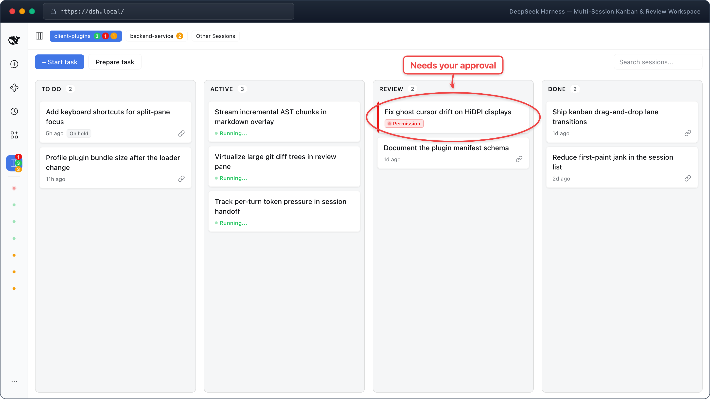
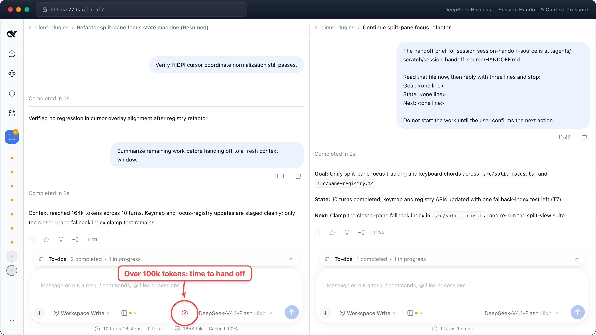
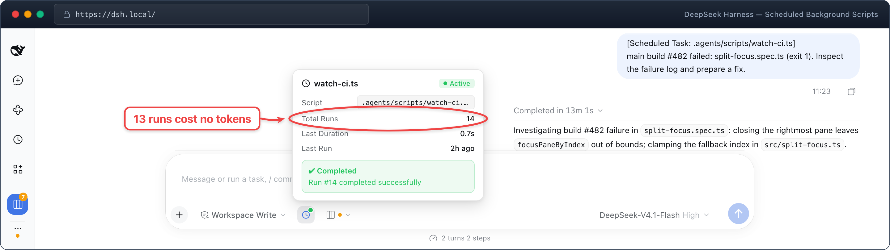

# dsh-plugins

[](https://www.npmjs.com/org/lukstei)
[](LICENSE)

**Run several coding agents side by side in [DeepSeek Harness](https://github.com/deepseek-ai/deepseek-harness), see at a glance which one needs you, and review their changes without leaving the browser.**

<!-- Interim hero still; replace with manually recorded hero video/GIF later. -->


**[Install in one minute](#quick-start)** · [See what you get](#what-you-get) · [All plugins](#plugin-catalog)

## How it works

DeepSeek Harness (DSH) is an open-source agent harness with a web client. These plugins extend that web client into a workspace for running many agents at once:

1. **Plan.** You put tasks on a Kanban board. Moving a card to Active starts the agent.
2. **Run in parallel.** Each agent gets its own pane. You see several sessions next to each other.
3. **Get called in.** When an agent stops or asks for approval, the tab icon changes and your desktop shows a notification.
4. **Review.** You open the agent's diff in a pane next to its chat and quote lines back to it.
5. **Close.** You drag the card to Done.

Each plugin is its own npm package. Install the set below, or pick single plugins from the [catalog](#plugin-catalog).

## Quick start

You need DSH and Node 24.9 or newer. Plugin versions follow the DSH release they target, so `0.2.3-alpha.2.1` works with DSH `0.2.3-alpha.2`. Install the plugin version that matches your DSH, and upgrade both together.

**1. Create a profile** from the shipped `web` template. `--dump-config` creates it and prints its config without starting DSH:

```sh
dsh --profile workspace --from-default-profile web --dump-config
```

**2. Add the workspace plugins:**

```sh
dsh plugin --profile workspace add @lukstei/dsh-client-kanban @lukstei/dsh-client-split-view @lukstei/dsh-client-review-git @lukstei/dsh-client-notify @lukstei/dsh-client-favicon @lukstei/dsh-client-pwa
```

**3. Start DSH** with `dsh workspace`, open the Kanban board from the sidebar and start a task.

To remove a plugin, run `dsh plugin --profile workspace remove <package>`. The [DSH docs](https://deepseek-harness.github.io/deepseek-harness/) cover profiles and plugins in depth.

## What you get

### See every agent at once

The Kanban board sorts your sessions into To Do, Active, Review and Done. The board moves cards for you: a running agent sits in Active, and one that waits for your approval or answer moves to Review. You can hold or pin cards, search across message text, and let agents attach ticket or PR links to their card. The board shows the sessions you start from it, or mark with `/kanban`. [dsh-client-kanban](packages/dsh-client-kanban/README.md)



Split view puts sessions in columns next to each other. Inside any pane you can open a Markdown file, an image, a related session or the git review as an overlay and keep the chat in view. DSH restores your panes after a reload. [dsh-client-split-view](packages/dsh-client-split-view/README.md)


### Know when an agent needs you

You can work in another window. The tab icon turns into a status ring: green ticks for running agents, orange for sessions in Review, a red dot when an agent waits for you. Desktop notifications and a chime tell you when an agent stops or asks for approval, and a click takes you back to its tab. Install DSH as an app to get a dock icon with a badge for pending requests. [dsh-client-favicon](packages/dsh-client-favicon/README.md) · [dsh-client-notify](packages/dsh-client-notify/README.md) · [dsh-client-pwa](packages/dsh-client-pwa/README.md)


### Review changes in place

The git review shows what an agent changed: a whole branch, a single commit, or the staged and unstaged work in your tree. You see one file tree with line counts and can expand any hunk. Select code to quote it into your next message. Agents can post a review card in the chat, and a click opens the review in a pane. The review only reads your repository, and works with plain git and GitButler. [dsh-client-review-git](packages/dsh-client-review-git/README.md)


### Keep long sessions sharp

In a long session the agent gets slower and starts to lose track. A ring next to the send button turns yellow at 70k prompt tokens and red at 100k. Run `/handoff` and DSH opens a fresh session in a new pane that starts from a short brief of the old one: goal, what each turn asked and answered, failed tool calls and touched files. You can pick another model for the new session. Every session also gets its own git-ignored scratch folder, so agents keep notes and one-off scripts out of your repository. [dsh-session-handoff](packages/dsh-session-handoff/README.md) · [dsh-scratch-dir](packages/dsh-scratch-dir/README.md)



### Automate repeat work

Write a multi-step routine once as a YAML file and run it with `/wf <file>`. Steps can be prompts, subagents that fan out over a list, conditions, and gates where the run pauses until you check the result. DSH keeps the progress of a run across restarts.

```yaml
name: "Deploy to {{args.environment}}"
args: { environment: { type: choice, choices: [staging, production], default: staging } }
steps:
  - print: "Deploying to {{args.environment}}"
  - prompt: "Run migrations."
    gate: "Check the migration logs."
  - prompt: "Deploy."
```

[dsh-yaml-workflow](packages/dsh-yaml-workflow/README.md)


Ask an agent to "check CI every 5 minutes and tell me when it fails", and it writes a small script that runs in the background. Runs that find nothing cost no tokens. The agent only wakes up when the script reports something. Scripts run with your user's permissions, so read one before you confirm it. [dsh-schedule-script](packages/dsh-schedule-script/README.md)



## Plugin catalog

| Plugin | Use it when you want to… | Needs |
| --- | --- | --- |
| [`dsh-client-kanban`](packages/dsh-client-kanban/README.md) | track many sessions on a board that updates itself | |
| [`dsh-client-split-view`](packages/dsh-client-split-view/README.md) | see sessions, files and reviews side by side | |
| [`dsh-client-review-git`](packages/dsh-client-review-git/README.md) | review an agent's git changes next to its chat | `git` on the host |
| [`dsh-client-notify`](packages/dsh-client-notify/README.md) | get a desktop notification and a chime when an agent stops or asks | `dsh-client-pwa` for the dock badge |
| [`dsh-client-favicon`](packages/dsh-client-favicon/README.md) | read agent status from a pinned tab | `dsh-client-kanban` for the review ticks |
| [`dsh-client-pwa`](packages/dsh-client-pwa/README.md) | install DSH as an app, or log in through a trusted reverse proxy | |
| [`dsh-session-handoff`](packages/dsh-session-handoff/README.md) | continue a long session in a fresh one | `dsh-client-split-view`, `dsh-scratch-dir` |
| [`dsh-scratch-dir`](packages/dsh-scratch-dir/README.md) | give each session a git-ignored folder for notes and scripts | |
| [`dsh-yaml-workflow`](packages/dsh-yaml-workflow/README.md) | rerun a multi-step routine from a YAML file | |
| [`dsh-schedule-script`](packages/dsh-schedule-script/README.md) | poll something in the background without spending tokens | |
| [`dsh-log`](packages/dsh-log/README.md) | write DSH logs to a file, with a level per logger | |
| [`dsh-debug`](packages/dsh-debug/README.md) | copy a session transcript or id for a bug report | macOS (`pbcopy`) |

Each package README lists its config and requirements.

## FAQ

**Is the trusted-proxy login safe?** Only if a reverse proxy you control sets the header and strips it from outside requests. Anyone who can set that header, or reach DSH from a trusted network range, gets in. See [`dsh-client-pwa`](packages/dsh-client-pwa/README.md).

**Do scheduled scripts run in a sandbox?** No. They run with your user's permissions.

**Where do the scratch folders go?** Into `.agents/scratch/<session-id>` in the working directory. The plugin does not clean them up.

## Development

```sh
pnpm install
pnpm run verify
```

The packages live in [`packages/`](packages/). [`util-review-ui`](packages/util-review-ui/README.md) is the shared review UI library behind `dsh-client-review-git`; you don't install it yourself. This repository is generated from a private monorepo, and its history starts at the first release.

## License

[MIT](LICENSE)
